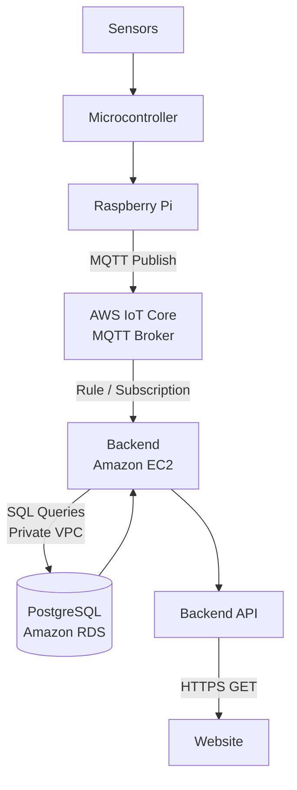

## Remote Monitoring System (RMS)
The RMS is intended to be a monitoring system that reads information from various sensors throughout the SMRT Project, sends it into a database and transfers it to a web application.

### Microcontroller
We use the Adafruit RP2040 Feather as our Microcontroller, and program it with the CircuitPython library. Several RP2040 Feathers can be connected to a Raspberry Pi, which processes and transfers the data to the RMS Website. 

### Primary Sensors
- _DPS310_ as a Temperature and Pressure Sensor
- _INA228_ as a Current, Voltage, and Power Sensor
- _SHT45_ as a Temperature and Humidity Sensor

### Individual Sensors 
- _High-precision Environmental Sensors Analog Type Wind Speed Sensor 3001-FS-Y10_ as Anemometer
- _EK1940 Soil Moisture Sensor_ as Moisture Sensor

### Website Data Pipeline

